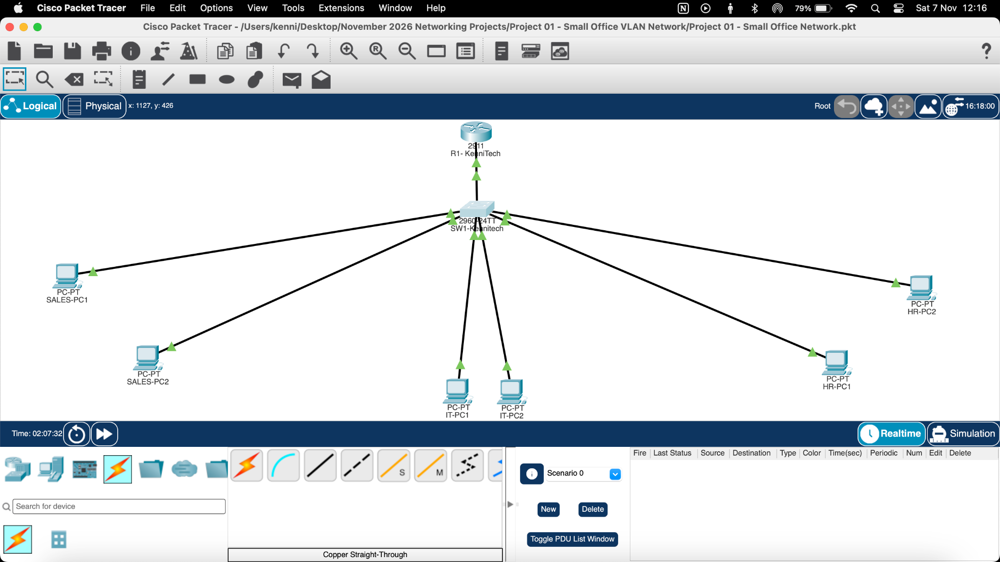

# KenniTech | Small Office VLAN Network

**Project 01 · Cisco Packet Tracer 9.x · 7 November 2026**

A small-office network simulation that separates Sales, IT and HR into distinct VLANs, provides inter-VLAN routing and DHCP, and applies extended IPv4 access control lists (ACLs) to enforce departmental access rules.

> This is a learning portfolio project. The screenshots and test results document the Packet Tracer simulation, not a production deployment.

## Project overview

The network uses a Cisco 2911 router and a Cisco 2960-24TT switch. Six PCs are connected to the switch, with two endpoints assigned to each department. The router uses 802.1Q subinterfaces (router-on-a-stick) to route between VLANs. DHCP is configured on the router.

### Topology



*Logical topology: one router, one central switch and six departmental endpoints.*

## Device inventory

| Device | Model | Role |
|---|---|---|
| R1-KenniTech | Cisco 2911 | Default gateways, inter-VLAN routing, DHCP and ACL enforcement |
| SW1-KenniTech | Cisco 2960-24TT | Layer 2 switching, VLAN access ports and 802.1Q trunk |
| Sales-PC1, Sales-PC2 | PC-PT | Sales clients, VLAN 10 |
| IT-PC1, IT-PC2 | PC-PT | IT clients, VLAN 20 |
| HR-PC1, HR-PC2 | PC-PT | HR clients, VLAN 30 |

## VLAN and IPv4 addressing plan

All departmental networks use a /24 prefix (subnet mask `255.255.255.0`).

| Department | VLAN | Network | Default gateway | DHCP addresses observed |
|---|---:|---|---|---|
| Sales | 10 | `192.168.10.0/24` | `192.168.10.1` | `192.168.10.11`, `.12` |
| IT | 20 | `192.168.20.0/24` | `192.168.20.1` | `192.168.20.11`, `.12` |
| HR | 30 | `192.168.30.0/24` | `192.168.30.1` | `192.168.30.11`, `.12` |

The DHCP configuration excludes addresses `.1` through `.10` in each subnet. The recorded DHCP binding output shows six automatic leases, two per department.

## Switch configuration

| VLAN | Name | Access ports |
|---:|---|---|
| 10 | SALES | Fa0/1, Fa0/2 |
| 20 | IT | Fa0/3, Fa0/4 |
| 30 | HR | Fa0/5, Fa0/6 |

The switch uplink **GigabitEthernet0/1** is configured as an IEEE 802.1Q trunk. Verification output shows VLANs 10, 20 and 30 active and forwarding across the trunk. VLAN 1 is also shown as the native/default VLAN.

Useful switch verification commands:

```text
show vlan brief
show interfaces trunk
show running-config
copy running-config startup-config
```

## Router configuration

The router uses the following subinterfaces:

| Subinterface | VLAN tag | Gateway | Recorded state |
|---|---:|---|---|
| G0/0.10 | 10 | `192.168.10.1/24` | up/up |
| G0/0.20 | 20 | `192.168.20.1/24` | up/up |
| G0/0.30 | 30 | `192.168.30.1/24` | up/up |

Useful router verification commands:

```text
show ip interface brief
show ip dhcp binding
show access-lists
show ip interface gigabitEthernet 0/0.10
show ip interface gigabitEthernet 0/0.30
show running-config
copy running-config startup-config
```

## Departmental access policy

The intended policy is:

| Source | Destination | Policy |
|---|---|---|
| Sales | IT | Block new Sales-initiated IP traffic |
| Sales | HR | Block new Sales-initiated IP traffic |
| IT | Sales | Allow |
| IT | HR | Allow |
| HR | IT | Block new HR-initiated IP traffic |
| HR | Sales | Allow |

### Extended ACLs

Two named extended ACLs are used:

- **SALES-IN**, applied inbound on `GigabitEthernet0/0.10`.
- **HR-IN**, applied inbound on `GigabitEthernet0/0.30`.

The ACLs place specific return-traffic permits before the broader deny entries.

**SALES-IN rule summary**

1. Permit established TCP from Sales to IT.
2. Permit ICMP echo-reply from Sales to IT.
3. Permit established TCP from Sales to HR.
4. Permit ICMP echo-reply from Sales to HR.
5. Deny other IP traffic from Sales to IT.
6. Deny other IP traffic from Sales to HR.
7. Permit remaining IP traffic.

**HR-IN rule summary**

1. Permit established TCP from HR to IT.
2. Permit ICMP echo-reply from HR to IT.
3. Deny other IP traffic from HR to IT.
4. Permit remaining IP traffic.

The `established` keyword matches TCP acknowledgement or reset flags. It is not full stateful firewall inspection. The ICMP echo-reply entries permit ping replies. Other return protocols, especially UDP, require their own design and validation.

## Connectivity tests

The final endpoint screenshots show these ICMP results:

| Source endpoint | Destination | Expected | Observed |
|---|---|---|---|
| Sales-PC1 | IT-PC1 (`192.168.20.11`) | Block | Blocked; 100% packet loss / destination host unreachable |
| Sales-PC1 | HR-PC1 (`192.168.30.11`) | Block | Blocked; 100% packet loss / destination host unreachable |
| IT-PC1 | Sales-PC1 (`192.168.10.11`) | Allow | Successful; 4 replies, 0% loss |
| IT-PC1 | HR-PC1 (`192.168.30.11`) | Allow | Successful; 4 replies, 0% loss |
| HR-PC1 | IT-PC1 (`192.168.20.11`) | Block | Blocked; 100% packet loss / destination host unreachable |
| HR-PC1 | Sales-PC1 (`192.168.10.11`) | Allow | Successful; 4 replies, 0% loss |

The screenshots also show ACL match counters on the relevant permit and deny entries, supporting that the ACL rules were exercised.

**Test scope:** these endpoint tests validate ICMP reachability and filtering. They do not, by themselves, prove every TCP or UDP application flow. A separate TCP service test should be performed before claiming full application-level validation.

## Evidence

The supplied Packet Tracer evidence screenshots are included in `screenshots/`:

| Filename | Evidence |
|---|---|
| `network-topology.webp` | Complete Packet Tracer logical topology |
| `vlan-configuration.webp` | `show vlan brief` output |
| `trunk-verification.webp` | `show interfaces trunk` output |
| `router-verification.webp` | Router subinterfaces, DHCP bindings and ACL output |
| `acl-interface-attachment.webp` | Inbound ACL attachment to Sales and HR subinterfaces |
| `sales-connectivity-tests.webp` | Sales tests to IT and HR |
| `it-connectivity-tests.webp` | IT tests to Sales and HR |
| `hr-connectivity-tests.webp` | HR tests to IT and Sales |


## Project documentation

The full project documentation is available in the [docs](docs/) folder:

- [PDF implementation and testing report](docs/KenniTech_Project_01_Small_Office_VLAN_Report.pdf)
- [Editable Word implementation and testing report](docs/Project_01_Network_Report.docx)
- [Markdown implementation and testing report](docs/implementation-and-testing-report.md)

## Repository structure

```text
small-office-vlan-network/
├── README.md
├── Project 01 - Small Office Network.pkt
├── docs/
│   ├── KenniTech_Project_01_Small_Office_VLAN_Report.pdf
│   ├── Project_01_Network_Report.docx
│   └── implementation-and-testing-report.md
└── screenshots/                 # add the evidence images here
    ├── network-topology.webp
    ├── vlan-configuration.webp
    ├── trunk-verification.webp
    ├── router-verification.webp
    ├── acl-interface-attachment.webp
    ├── sales-connectivity-tests.webp
    ├── it-connectivity-tests.webp
    └── hr-connectivity-tests.webp
```

The Packet Tracer file, reports and eight evidence screenshots are committed in this repository.

## Configuration backup

Both router and switch running configurations were copied to startup configuration. Packet Tracer displayed `[OK]` for each save operation.

Recommended persistence check: reopen the `.pkt` project and repeat the verification commands above.

## Skills practised

- Cisco IOS command-line navigation and configuration
- IPv4 addressing and /24 subnetting
- VLAN creation and access-port assignment
- IEEE 802.1Q trunking
- Router-on-a-stick inter-VLAN routing
- DHCP pools and bindings
- Named extended IPv4 ACLs
- ICMP connectivity testing and troubleshooting
- Configuration backup and technical documentation

## Author

**KenniTech**  
Networking learning portfolio · Cisco Packet Tracer

This project is part of an ongoing practical learning programme. The goal is to develop repeatable configuration, verification, troubleshooting and documentation skills through progressively more challenging labs.
